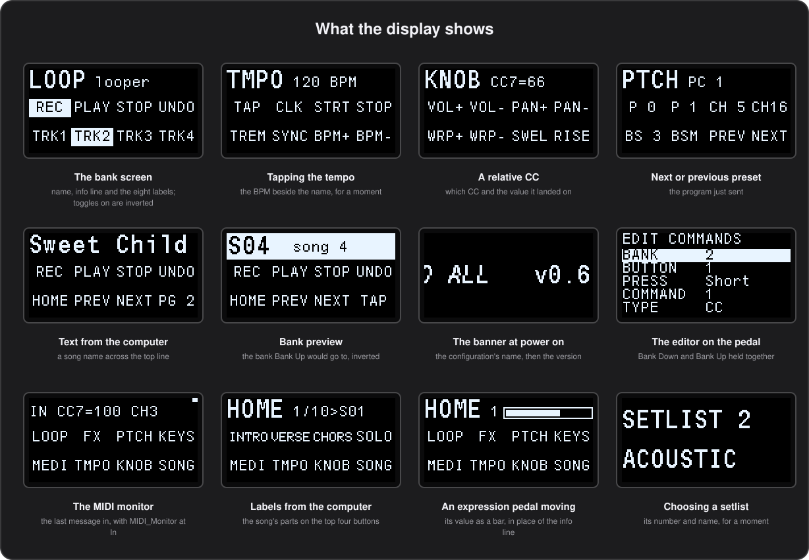
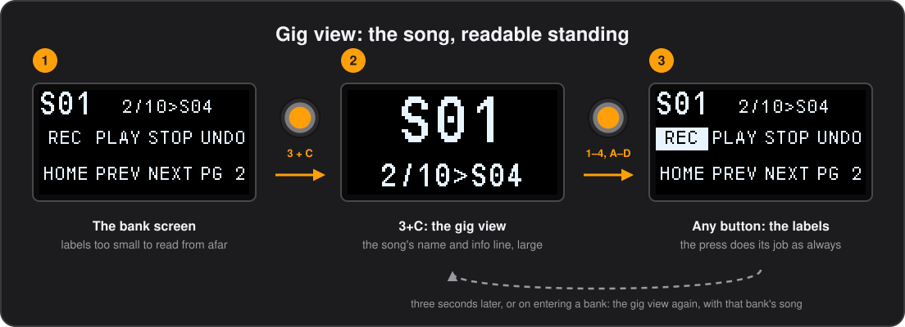

# The display

**English** · [Español](../es/09-the-display.md)

The pedal's 128×64 screen tells you where you are and what is on, at a glance from the floor. This chapter covers the bank screen, what shows over it for a moment, the gig view, the MIDI monitor, the live values a label can show and the preset names it can show them by, the text and button labels a computer can put on it, and the banner at power on.

## The bank screen



What the display shows most of the time:

- **Top line, left:** the bank's name, 4 characters in large letters. The large letters are capitals only: lowercase shows as capitals there, and `` ` ``, `{`, `|`, `}` and `~` as `?`; the small ones have both.
- **Top line, right:** its info line, 8 characters in small letters.
- **Below:** a 2×4 grid laid out like the pedal, buttons **1 2 3 4** on the top row and **A B C D** on the bottom. Each cell shows the button's label, or its identifier when it has none.
- **Toggles:** the cell of a toggle button is drawn inverted while the toggle is on, so the state of the whole bank shows at a glance.
- **Ten switches:** with `Bank_Switch_Mode` at `MIDI only` and a label on Bank Down or Bank Up, the grid is 2×5, the bank switches in the fifth column, and the labels in smaller letters ([On the screen](04-banks.md#what-the-bank-switches-send)).

A [cycle button](05-buttons.md#cycle-buttons) shows the label of the state it last sent, and a [second page](04-banks.md#second-page) shows the page's labels in place of the bank's. With `Setlist_Display` on, a song of the setlist shows its place in it and the next song in the info line, `3/12>INTR` ([Where you are in it](04-banks.md#where-you-are-in-it)). With `Kemper_Mode` on, the rig you are on takes the info line, and the amp's tuner the whole screen while it is up ([Two way with a Kemper](11-devices.md#two-way-with-a-kemper)); with `GT1000_Mode` on, the GT-1000's patch name takes it ([Two way with a GT-1000](11-devices.md#two-way-with-a-gt-1000)).

### What shows over it

Some things take the screen, or part of it, for a moment and then give the bank screen back:

| When | What you see |
|---|---|
| Tapping the tempo, starting or stopping the clock, or setting or stepping the tempo | the tempo, with a leading `*` while the clock is running ([Tempo](07-tempo.md)) |
| `Clock_Follow` picks up the host's clock, or its tempo changes | `EXT` and the tempo, for 1.5 seconds |
| A clock running, with `Beat_Counter` on | the bar, the beat and the tempo in place of the info line, `12.3 120`, for as long as it runs ([Bar and beat on the display](07-tempo.md#bar-and-beat-on-the-display)) |
| A count-in (`Wait` `Count`) | the beats left in place of the bank's name, `IN 4` to `IN 1`, until the list goes ([On the beat](06-commands.md#on-the-beat)) |
| MIDI coming in over USB, with `MIDI_Monitor` on | a mark in the top right corner; with `In` or `All` the message across the top line for two seconds ([MIDI monitor](#midi-monitor)) |
| A relative CC button | the CC number and the value just sent, in place of the info line for 1.5 seconds: `CC7=69`, or `C120=127` for three digit CC numbers |
| An expression pedal moving, with `Display` on | the value it sends, `EXP1 64`, or the pedal's number and a bar, in place of the info line until 1.5 seconds after it stops ([Its value on the display](08-expression.md#its-value-on-the-display)) |
| A next or previous preset button | the new program's [name](#preset-names), or its number, as `PC 6` |
| Choosing a setlist (`Setlist`) | `SETLIST 2` and the setlist's name, full screen; `NO SONGS` when it has none ([Several setlists](04-banks.md#several-setlists)) |
| Locking or unlocking the switches | `LOCKED` or `UNLOCKED`; `LOCKED` then stays in the info line ([Locking the switches](05-buttons.md#locking-the-switches)) |
| A `Direct` button | `BANK0-31` and the four groups, then the group's banks, `BANK16-23` ([Any bank in two presses](04-banks.md#any-bank-in-two-presses)) |
| Saving a scene (`Scene` `Save`) | **SAVED SCENE**, for three seconds ([Saving a scene with your feet](05-buttons.md#saving-a-scene-with-your-feet)) |
| Saving the tempo (`Tap` `Save`) | **SAVED TEMPO 120 BPM**, or **NOT SAVED ENTER LIST FULL** ([Keeping the tempo you tapped](07-tempo.md#keeping-the-tempo-you-tapped)) |
| Recording presses | `REC WAIT`, `REC OFF`, `SAVED` and the count, `PLAY ON`, `PLAY OFF`, `ERASED`, `REC FULL` ([Recording a run of presses](07-tempo.md#recording-a-run-of-presses)) |
| Switching configuration | the new configuration's number and name, full screen; a short notice when the slot asked for is empty |
| Bank Up / Down with `Bank_Preview` on | the bank they would go to, its name inverted, white with black letters, over its labels ([Bank preview](04-banks.md#bank-preview)) |
| Starting in safe mode | **SAFE MODE**, for three seconds ([Safe mode](10-editing-on-the-pedal.md#safe-mode)) |
| A configurator writing the slot the pedal runs | **RECEIVING CONFIGURATION**, until the pedal restarts ([Sidebar](03-the-configurator.md#sidebar)) |
| Restarting after a lock-up | **RESTARTED AFTER A LOCK-UP** ([If something goes wrong](02-getting-started.md#if-something-goes-wrong)) |
| Power on | the configuration's name (`ConfigName`) and the firmware version for a moment, or the [banner](#the-banners-own-text) crossing the screen when `Boot_Banner` is on |
| Waiting for a firmware update | **FIRMWARE UPDATE** |

While a bank preview shows, readouts such as the tempo are skipped, and text from the computer waits under it until the preview is over.

### When it goes dark

With `Sleep_After_Min` set, the display and the LEDs switch off after that many minutes with nobody touching the pedal. Any press or expression pedal movement brings them back, and the press that wakes it still does its job. They also go off while the computer the pedal is connected to sleeps, and come back when it wakes. A bank changed from the computer while the pedal sleeps changes in the dark: the LEDs show it when the pedal wakes. See the [global settings](12-configuration-file.md#global_settings).

## Gig view

From a few steps back, or with the pedal on the floor and you standing, the 4-character labels are hard to read, and what you look for between songs is which song you are on. The gig view gives the whole screen to the song: the bank's name in letters twice the size of the large font, and its info line in the large font under it.



- **Turn it on and off** with a `Bank` command whose **Action** is `GigView`, best in a [combination](05-buttons.md#two-switches-together) or a long press, so it does not take a button of its own. The demo does it with **3+C**, in every bank.
- **From power on:** tick **Gig view** in the configurator's **Global** tab, `Gig_View` in the CSV.
- **A press brings the labels back.** Press any of the eight buttons and it does its job as always, and the labels and toggle states come back for three seconds, then the song again.
- **Entering a bank keeps it,** so the next song's name shows as soon as you get there. A bank preview shows as it always does.
- **What it shows** is what the top line would: the bank's name and info line with their [live values](#live-values), the count-in in place of the name, the bar and beat or the place in the setlist in place of the info line, `LOCKED`, and [text from the computer](#text-from-the-computer), which takes the name's place when it is sent for the whole line or for the name. A name of more than five characters shows in the large font, eleven to the screen, and a longer one scrolls as it does on the top line.
- **Readouts** such as the tempo or a pedal's value show in the info line's place, in the large font.
- It is not kept across a power cycle: the pedal starts as `Gig_View` says. Needs firmware 1.32.

## MIDI monitor

At soundcheck, when a device does not answer, the first question is whether MIDI is getting through at all, and the laptop that would show it is packed away. The display can answer it. Set `MIDI_Monitor` in the configurator's **Global** tab, **MIDI monitor**:

| `MIDI_Monitor` | What the display shows |
|---|---|
| `Off` | nothing, as before. The default. |
| `Mark` | a small mark in the top right corner, lit while MIDI comes in over USB and for a moment after. The demo has it. |
| `In` | the mark, and the last message received across the top line for two seconds, in small letters: `IN CC7=100 CH3`. |
| `All` | the mark, and the last message received or sent: `OUT PC12 CH1` when a button sends a program change. |

- **How messages read:** `CC7=100` a control change and its value, `PC12` a program change, `ON60=127` and `OFF60` a note and its velocity, `AT=9` channel pressure and `AT60=9` a note's, `PB=8192` pitch bend from 0 to 16383, then `CH1` to `CH16`. A SysEx shows as `SYSEX`, and `START`, `CONTINUE`, `STOP`, `SPP` (song position), `SONG`, `TUNE` and `RESET` as such; any other system message shows as `SYS` and its status byte, `SYS241`.
- **Not shown:** the MIDI clock and active sensing, which come all the time and would keep the mark lit; the configurator's own SysEx; and, with `USB_Ports` at 3, what comes in on the DIN port's cable to go straight out of the DIN socket.
- **A stream** of messages, a DAW's automation or an expression pedal sweeping, shows the latest one; nothing waits for the screen.
- **Over the rest:** the message stands where the bank's name and info line are and gives them back after two seconds. An expression pedal's value goes over it, since it says more about the pedal. In the [gig view](#gig-view) it shows in the info line's place.
- Needs firmware 1.35. It is kept in bits 3-4 of global byte 46, beside the banner's speed and `Gig_View`; firmware 1.32 to 1.34 ignores it, and older firmware shows no banner when it is on.

## Live values

*Needs firmware 1.20 or later.*

A label, a bank's name or its info line can show a value as it is now in place of fixed text: the preset the amp is on, by its name, the value a relative CC has reached, a counter, the tempo. Write a `$` and a letter where the value goes. The pedal fills it in, and draws the screen again as soon as one of the values on it changes, under a readout too.

| Write | It shows |
|---|---|
| `$V` | In a label, the button's value, from the first `CCInc`, `PC`, `PCInc` or `Value` command of its press list: the value a `CCInc` last sent, or starts from before its first press; the program a `PCInc` is on; the program a `PC` selects; the value a `Value` command changes. In the bank's name or info line, the program last selected on `MIDI_Channel`. |
| `$N` | The same, a program shown by its name in the [preset names](#preset-names) when it has one |
| `$1` to `$8` | One of the eight values of the [`Value` command](06-commands.md#values-and-conditions) |
| `$T` | The tempo |
| `$$` | A `$` |

A program nothing has selected yet, or a button with none of those commands, shows `-`. Lowercase works too, `$v`, and a `$` followed by anything else stays as it is.

The program is kept for each channel, whoever selected it: a `PC` command, a bank's enter list, a [next or previous preset](06-commands.md#next-and-previous-preset) button, or the computer over USB. So a `PCInc` button labelled `$N` names the preset you are on, and a `PC` button labelled `$N` the one it selects.

A label is 4 characters, so `$V` leaves room for two more: `V$V` shows `V64`. A value that makes it one character longer, `W:112`, is drawn in the small letters; past that, and in the ten cell grid, it is cut. The bank's name keeps its 4 characters and the info line its 8.

In the demo, bank PTCH's info line is `$N`: entering the bank shows `CLEAN`, NEXT and PREV step through the names, and a Program Change from the computer shows there too. Bank MIX's info line, `mixed $1`, counts as ALL5 is held.

### Preset names

Names for the programs 0–127 of your device, up to 8 characters each, for `$N`. In the configurator they are the **Presets** tab, in the browser **Preset names**, and in the [file](12-configuration-file.md) the `Preset_Names` section, a row per named program:

```
* Preset_Names
Program,Name
0,CLEAN
1,CRUNCH
```

One table serves every channel. A program with no name shows its number. A next or previous preset button shows the name for a moment too: `CRUNCH`, where it used to show `PC 1`.

They are kept in the second extension area, after the bank switches' labels, 8 bytes per program; older firmware ignores them, and shows `$N` as it is written.

## Text from the computer

A DAW, MainStage or a script can write on the top line: the name of the patch or song it has just loaded, a note for the next part, anything you want to see from the floor.

*Needs firmware 0.46 or later; scrolling needs 0.61.*

### Where and for how long

The text can go in four places, and stay for three lengths of time:

| Place | Where | Fits without scrolling |
|---|---|---|
| `info` | the small info line right of the bank name | 11 characters |
| `name` | the large bank name | 4 characters |
| `line` | the whole top line, large | 11 characters |
| `small` | the whole top line, small | 18 characters |

| Keep | How long |
|---|---|
| `bank` | until the bank changes |
| `always` | until the computer changes it |
| `moment` | 1.5 seconds, like the tempo readout |

- An empty text gives the place back to what the bank shows.
- A whole line text hides the bank name and info while it is there. The large and small whole lines replace each other.
- A text in the bank name or info shows even over a whole line text.
- A text shown for a moment goes back to what was there before.
- Text also wakes the display if the pedal was asleep.

The text is plain ASCII, one character per byte, and a byte the display cannot draw shows as a space. `Send_Text.py` and the configurator send `Canción` as `Cancion`, like the [names in a configuration](12-configuration-file.md). Up to 32 characters are kept in any place, and more are cut off.

### Longer than fits

A text wider than its place scrolls across it once, so the whole song name gets read:

1. It stays still for a moment.
2. It moves along at about 40 pixels a second until its end shows.
3. It stays still again, then goes back to its beginning, where it stays.

It scrolls when it arrives, and again whenever a bank is entered. The same text sent again leaves it where it is, so a host that repeats itself does not keep it moving. Only its own place moves: a long info line scrolls beside a still bank name. A long text for a moment stays up until it has reached its end, however long that takes past the 1.5 seconds. Scrolling never holds up a press.

### Sending it from a terminal

`Send_Text.py` builds the message and sends it, or prints the bytes for a host to send:

```bash
.venv/bin/python python/Send_Text.py "Sweet Child"                      # whole line, large, until the bank changes
.venv/bin/python python/Send_Text.py --place info --keep always "Clean"  # the info line, for good
.venv/bin/python python/Send_Text.py --keep moment "Next: Intro"        # for a moment
.venv/bin/python python/Send_Text.py "Sweet Child O' Mine"              # too long for the line: scrolls once
.venv/bin/python python/Send_Text.py ""                                 # back to the bank
.venv/bin/python python/Send_Text.py --hex "Sweet Child"                # only print the bytes, for a host to send
```

`--place` is `info`, `name`, `line` (the default) or `small`, and `--keep` is `bank` (the default), `always` or `moment`.

<details><summary>Under the hood</summary>

The message is one SysEx:

```
F0 7D 48 place how text... F7
```

`place` is `00` for the info line, `01` for the bank name, `02` for the whole line in large letters and `03` for the whole line in small ones. `how` is `00` until the bank changes, `01` until the host changes it and `02` for 1.5 seconds. The text bytes are `20`–`7E`.

For example, `F0 7D 48 02 00 53 77 65 65 74 20 43 68 69 6C 64 F7` puts **Sweet Child** across the top line until the bank changes.

The pedal answers `F0 7D 49 place how F7`, and ignores a place or `how` it does not know. It draws a scroll step only once the previous screen has gone out, which is why scrolling never holds a press up. Firmware before 0.61 keeps only what fits.

</details>

### From REAPER

`hosts/reaper/MIDI_Commander_song_names.lua` is a ReaScript that writes the song you are in on the pedal, as REAPER plays:

- **The song** is the region under the play cursor, or under the edit cursor when stopped, across the top line until the next song. With no region there, the project's name stands for the song, for one project per song.
- **The part** is a marker passed while playing, `Chorus` or `Solo`, shown over the song for a moment.
- **The transport**, if you want it: play, record, repeat and the metronome as CCs, 127 when on and 0 when off, so a toggle button sending the same CC lights with them, with `LED_Feedback` on.

To use it:

1. In REAPER, tick the pedal's output, **MIDI Commander Custom**, as **Enabled** in **Preferences > Audio > MIDI Inputs/Outputs**. No track has to send to it.
2. **Actions > Show action list > New action > Load ReaScript**, and pick the file.
3. Run it. It keeps running, lit in a toolbar button, until it is run again; then it gives the line back to the bank.

The settings are at the top of the file: where the song goes (`line`, `small`, `name` or `info`), where the part goes or none, whether the project's name is used, and the CC for each part of the transport, none by default. The names are spelled as the tools spell them, `Canción` as `Cancion`. It sends the song again every five seconds, which the pedal takes without a flicker, so a pedal plugged in while it runs catches up. Tried on REAPER 7.79.

### Button labels

A script or a DAW that drives the pedal can also write each button's label: the scene it just named, the effect it moved to button A. The button still sends what the configuration says; only its label changes. *Needs firmware 1.34 or later.*

- A label from the computer has up to five characters, in the small letters past four, as a [live value](#live-values) does. In the [ten cell layout](04-banks.md#what-the-bank-switches-send) the cells take four, Bank Down and Bank Up included, which the computer can write too while they show.
- It stays until the bank changes, or until the computer changes it, wherever you go.
- An empty label gives the button back its own, and one message can give all of them back.
- A toggle still shows inverted while it is on, and the [gig view](#gig-view) hides the labels as always.

```bash
.venv/bin/python python/Send_Text.py --button A DLY                 # button A, until the bank changes
.venv/bin/python python/Send_Text.py --button 1 --keep always Lead  # button 1, until the computer changes it
.venv/bin/python python/Send_Text.py --button all ""                # every button back to its own label
.venv/bin/python python/Send_Text.py --button A --hex DLY           # only print the bytes, for a host to send
```

`--button` is `1`–`4`, `A`–`D`, `Down`, `Up` or `all`, and `--keep` is `bank` (the default) or `always`.

<details><summary>Under the hood</summary>

```
F0 7D 52 button how label... F7
```

`button` is `00`–`03` for 1–4, `04`–`07` for A–D, `08` for Bank Down, `09` for Bank Up and `7F` for all of them. `how` is `00` until the bank changes and `01` until the host changes it. The label bytes are `20`–`7E`; past five, they are cut off.

For example, `F0 7D 52 04 00 44 4C 59 F7` writes **DLY** on button A until the bank changes.

The pedal answers `F0 7D 53 button how F7`, and ignores a button or `how` it does not know. Labels from the computer are not kept through power off, and `GET_STATE` still reports the configuration's.

</details>

## The banner's own text

At power on, with `Boot_Banner` on, the [banner](12-configuration-file.md#global_settings) crosses the display with the configuration's name. The pedal can hold a text of its own to show instead: up to 60 characters of plain ASCII, such as a band, a show or a phone number in case the pedal gets lost.

- It belongs to the pedal, not to a configuration, so it stays whichever of the four configurations is loaded.
- It survives flashing a configuration and updating the firmware.
- It shows only while `Boot_Banner` is on, at its speed, followed by the firmware version, as the name is.

*Needs firmware 0.63 or later.*

In the configurator, **Banner Text…** under PEDAL reads the text from the pedal and stores, clears or keeps it. From a terminal:

```bash
.venv/bin/python python/Send_Text.py --banner "The Band  612 345 678"   # store it
.venv/bin/python python/Send_Text.py --banner                           # print what the pedal holds
.venv/bin/python python/Send_Text.py --banner ""                        # clear it: the name again
```

<details><summary>Under the hood</summary>

Over SysEx, `F0 7D 4C 01 text... F7` stores it, the same with no text clears it, and `F0 7D 4C 00 F7` only asks. The pedal answers `F0 7D 4D result text... F7`: `result` is 0, or 1 when it refused a text longer than 60 characters or with a byte outside `20`–`7E` and kept the one it had, followed by the text it holds.

The text sits in a flash page of its own at `0x0803A000`, past the fourth configuration slot, which nothing else writes. A blank or damaged page reads as no text.

</details>

---

[← Expression pedals](08-expression.md) · [Contents](README.md) · [Editing on the pedal →](10-editing-on-the-pedal.md)
