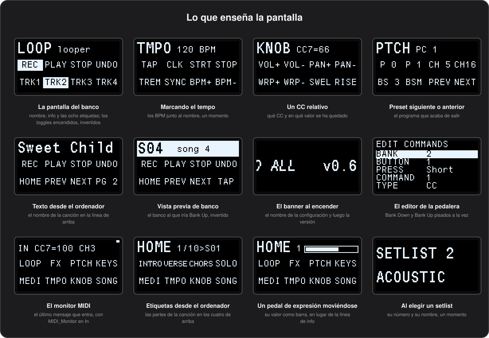
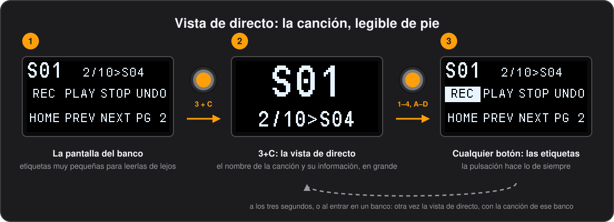

# La pantalla

[English](../en/09-the-display.md) · **Español**

La pantalla de 128×64 de la pedalera te dice dónde estás y qué está encendido, de un vistazo desde el suelo. Este capítulo trata la pantalla del banco, lo que aparece encima un momento, la vista de directo, el monitor MIDI, los valores en vivo que puede mostrar una etiqueta y los nombres de preset con que puede mostrarlos, el texto y las etiquetas de los botones que puede poner un ordenador y el banner al encender.

## La pantalla del banco



Lo que muestra la pantalla casi todo el tiempo:

- **Línea de arriba, a la izquierda:** el nombre del banco, 4 caracteres en letra grande. La letra grande solo tiene mayúsculas: las minúsculas salen ahí como mayúsculas, y `` ` ``, `{`, `|`, `}` y `~` como `?`; la pequeña tiene las dos.
- **Línea de arriba, a la derecha:** su línea de información, 8 caracteres en letra pequeña.
- **Debajo:** una rejilla de 2×4 colocada como la pedalera, con los botones **1 2 3 4** en la fila de arriba y **A B C D** en la de abajo. Cada casilla muestra la etiqueta del botón, o su identificador si no tiene.
- **Toggles:** la casilla de un toggle se dibuja invertida mientras está encendido, así que el estado de todo el banco se ve de un vistazo.
- **Diez pulsadores:** con `Bank_Switch_Mode` en `MIDI only` y una etiqueta en Bank Down o Bank Up, la rejilla es de 2×5, con los pulsadores de banco en la quinta columna y las etiquetas en letra más pequeña ([En la pantalla](04-banks.md#lo-que-envían-los-pulsadores-de-banco)).

Un [botón de ciclo](05-buttons.md#botones-de-ciclo) muestra la etiqueta del último estado que envió, y una [segunda página](04-banks.md#segunda-página) muestra las etiquetas de la página en lugar de las del banco. Con `Setlist_Display` activado, una canción del setlist muestra su puesto en él y la canción siguiente en la línea de información, `3/12>INTR` ([Dónde estás en ella](04-banks.md#dónde-estás-en-ella)). Con `Kemper_Mode` activado, el rig en el que estás ocupa la línea de información, y el afinador del ampli toda la pantalla mientras está abierto ([Kemper en las dos direcciones](11-devices.md#kemper-en-las-dos-direcciones)); con `GT1000_Mode` activado, la ocupa el nombre del patch de la GT-1000 ([GT-1000 en las dos direcciones](11-devices.md#gt-1000-en-las-dos-direcciones)).

### Lo que aparece encima

Algunas cosas ocupan la pantalla, o parte de ella, un momento y luego devuelven la pantalla del banco:

| Cuándo | Qué ves |
|---|---|
| Al marcar el tempo con el tap, arrancar o parar el reloj, o fijar o subir y bajar el tempo | el tempo, con un `*` delante mientras el reloj está en marcha ([Tempo](07-tempo.md)) |
| Cuando `Clock_Follow` engancha el reloj del ordenador, o cambia su tempo | `EXT` y el tempo, durante 1,5 segundos |
| Con un reloj en marcha y `Beat_Counter` activado | el compás, el tiempo y el tempo en lugar de la línea de información, `12.3 120`, mientras corra ([Compás y tiempo en la pantalla](07-tempo.md#compás-y-tiempo-en-la-pantalla)) |
| Una cuenta atrás (`Wait` `Count`) | los tiempos que faltan en lugar del nombre del banco, de `IN 4` a `IN 1`, hasta que sale la lista ([A tiempo](06-commands.md#a-tiempo)) |
| MIDI que entra por USB, con `MIDI_Monitor` activado | una marca en la esquina de arriba a la derecha; con `In` o `All`, el mensaje en toda la línea de arriba durante dos segundos ([Monitor MIDI](#monitor-midi)) |
| Un botón de CC relativo | el número de CC y el valor que se acaba de enviar, en lugar de la línea de información durante 1,5 segundos: `CC7=69`, o `C120=127` para números de CC de tres cifras |
| Un pedal de expresión moviéndose, con `Display` activado | el valor que envía, `EXP1 64`, o el número del pedal y una barra, en lugar de la línea de información hasta 1,5 segundos después de pararse ([Su valor en la pantalla](08-expression.md#su-valor-en-la-pantalla)) |
| Un botón de preset siguiente o anterior | el [nombre](#nombres-de-preset) del nuevo programa, o su número, como `PC 6` |
| Al elegir un setlist (`Setlist`) | `SETLIST 2` y el nombre del setlist, a pantalla completa; `NO SONGS` si no tiene canciones ([Varios setlists](04-banks.md#varios-setlists)) |
| Al bloquear o desbloquear los pulsadores | `LOCKED` o `UNLOCKED`; luego `LOCKED` se queda en la línea de información ([Bloquear los pulsadores](05-buttons.md#bloquear-los-pulsadores)) |
| Un botón `Direct` | `BANK0-31` y los cuatro grupos, luego los bancos del grupo, `BANK16-23` ([Cualquier banco en dos pulsaciones](04-banks.md#cualquier-banco-en-dos-pulsaciones)) |
| Al guardar una escena (`Scene` `Save`) | **SAVED SCENE**, durante tres segundos ([Guardar una escena con los pies](05-buttons.md#guardar-una-escena-con-los-pies)) |
| Al guardar el tempo (`Tap` `Save`) | **SAVED TEMPO 120 BPM**, o **NOT SAVED ENTER LIST FULL** ([Guardar el tempo que has marcado](07-tempo.md#guardar-el-tempo-que-has-marcado)) |
| Al grabar pulsaciones | `REC WAIT`, `REC OFF`, `SAVED` y el número, `PLAY ON`, `PLAY OFF`, `ERASED`, `REC FULL` ([Grabar una serie de pulsaciones](07-tempo.md#grabar-una-serie-de-pulsaciones)) |
| Al cambiar de configuración | el número y el nombre de la nueva configuración, a pantalla completa; un aviso breve si la ranura pedida está vacía |
| Bank Up / Down con `Bank_Preview` activado | el banco al que irían, con el nombre invertido, blanco con letras negras, sobre sus etiquetas ([Vista previa de banco](04-banks.md#vista-previa-de-banco)) |
| Al arrancar en modo seguro | **SAFE MODE**, durante tres segundos ([Modo seguro](10-editing-on-the-pedal.md#modo-seguro)) |
| Un configurador escribiendo el slot en marcha | **RECEIVING CONFIGURATION**, hasta que la pedalera se reinicia ([Barra lateral](03-the-configurator.md#barra-lateral)) |
| Al reiniciarse tras un bloqueo | **RESTARTED AFTER A LOCK-UP** ([Si algo sale mal](02-getting-started.md#si-algo-sale-mal)) |
| Al encender | el nombre de la configuración (`ConfigName`) y la versión de firmware un momento, o el [banner](#el-texto-propio-del-banner) cruzando la pantalla cuando `Boot_Banner` está activado |
| Esperando una actualización de firmware | **FIRMWARE UPDATE** |

Mientras se ve una vista previa de banco, los avisos como el del tempo se saltan, y el texto del ordenador espera debajo hasta que termina la vista previa.

### Cuándo se apaga

Con `Sleep_After_Min` puesto, la pantalla y los LEDs se apagan tras ese número de minutos sin que nadie toque la pedalera. Cualquier pulsación o movimiento de un pedal de expresión los vuelve a encender, y la pulsación que la despierta sigue haciendo su trabajo. También se apagan mientras duerme el ordenador al que está conectada la pedalera, y vuelven cuando se despierta. Un banco que cambia el ordenador mientras la pedalera duerme cambia a oscuras: los LEDs lo muestran cuando se despierta. Mira los [ajustes globales](12-configuration-file.md#global_settings).

## Vista de directo

A unos pasos, o con la pedalera en el suelo y tú de pie, las etiquetas de 4 caracteres se leen mal, y lo que buscas entre canciones es en qué canción estás. La vista de directo da toda la pantalla a la canción: el nombre del banco en letras del doble del tamaño de la fuente grande, y su línea de información en la fuente grande debajo.



- **Se activa y desactiva** con un comando `Bank` cuya **Action** es `GigView`, mejor en una [combinación](05-buttons.md#dos-pulsadores-a-la-vez) o en una pulsación larga, para que no ocupe un botón propio. La demo lo hace con **3+C**, en todos los bancos.
- **Desde el encendido:** marca **Gig view** en la pestaña **Global** del configurador, `Gig_View` en el CSV.
- **Una pulsación devuelve las etiquetas.** Pulsa cualquiera de los ocho botones y hace lo de siempre, y las etiquetas y el estado de los toggles vuelven durante tres segundos; luego, otra vez la canción.
- **Al entrar en un banco se mantiene,** así que el nombre de la siguiente canción aparece en cuanto llegas. La vista previa de un banco se ve como siempre.
- **Lo que muestra** es lo que mostraría la línea de arriba: el nombre del banco y su línea de información con sus [valores en vivo](#valores-en-vivo), la cuenta atrás en lugar del nombre, el compás y el tiempo o el puesto en el setlist en lugar de la línea de información, `LOCKED`, y el [texto del ordenador](#texto-desde-el-ordenador), que ocupa el sitio del nombre cuando se envía para toda la línea o para el nombre. Un nombre de más de cinco caracteres sale en la fuente grande, once por pantalla, y uno más largo se desplaza como en la línea de arriba.
- **Los avisos** como el tempo o el valor de un pedal salen en el sitio de la línea de información, en la fuente grande.
- No se guarda al apagar: la pedalera arranca como diga `Gig_View`. Necesita el firmware 1.32.

## Monitor MIDI

En la prueba de sonido, cuando un aparato no responde, la primera pregunta es si llega MIDI, y el portátil que lo diría está guardado. La pantalla puede responderla. Ajusta `MIDI_Monitor` en la pestaña **Global** del configurador, **MIDI monitor**:

| `MIDI_Monitor` | Lo que muestra la pantalla |
|---|---|
| `Off` | nada, como antes. Por defecto. |
| `Mark` | una marca pequeña en la esquina de arriba a la derecha, encendida mientras entra MIDI por USB y un momento después. La demo la tiene. |
| `In` | la marca, y el último mensaje recibido en toda la línea de arriba durante dos segundos, en letra pequeña: `IN CC7=100 CH3`. |
| `All` | la marca, y el último mensaje recibido o enviado: `OUT PC12 CH1` cuando un botón envía un cambio de programa. |

- **Cómo se leen los mensajes:** `CC7=100` un control change y su valor, `PC12` un program change, `ON60=127` y `OFF60` una nota y su velocidad, `AT=9` la presión del canal y `AT60=9` la de una nota, `PB=8192` el pitch bend de 0 a 16383, y luego de `CH1` a `CH16`. Un SysEx sale como `SYSEX`, y `START`, `CONTINUE`, `STOP`, `SPP` (posición en la canción), `SONG`, `TUNE` y `RESET` tal cual; cualquier otro mensaje de sistema sale como `SYS` y su byte de estado, `SYS241`.
- **No se muestran:** el reloj MIDI y el active sensing, que llegan todo el rato y dejarían la marca siempre encendida; el SysEx del propio configurador; y, con `USB_Ports` a 3, lo que entra por el cable del puerto DIN para salir directo por la toma DIN.
- **Una ráfaga** de mensajes, la automatización de un DAW o un pedal de expresión barriendo, muestra el último; nada espera a la pantalla.
- **Encima del resto:** el mensaje ocupa el sitio del nombre del banco y de su línea de información y se los devuelve a los dos segundos. El valor de un pedal de expresión se pone encima, porque dice más del pedal. En la [vista de directo](#vista-de-directo) sale en el sitio de la línea de información.
- Necesita el firmware 1.35. Se guarda en los bits 3-4 del byte global 46, junto a la velocidad del banner y `Gig_View`; los firmwares 1.32 a 1.34 lo ignoran, y uno anterior no muestra el banner cuando está activado.

## Valores en vivo

*Necesita firmware 1.20 o posterior.*

Una etiqueta, el nombre de un banco o su línea de información pueden mostrar un valor tal como está ahora en lugar de un texto fijo: el preset en el que está el ampli, con su nombre, el valor al que ha llegado un CC relativo, un contador, el tempo. Escribe un `$` y una letra donde va el valor. La pedalera lo rellena, y vuelve a dibujar la pantalla en cuanto cambia uno de los valores que hay en ella, también debajo de un aviso.

| Escribe | Muestra |
|---|---|
| `$V` | En una etiqueta, el valor del botón, del primer comando `CCInc`, `PC`, `PCInc` o `Value` de su lista de pulsación: el valor que envió por última vez un `CCInc`, o del que parte antes de la primera pulsación; el programa en el que está un `PCInc`; el programa que selecciona un `PC`; el valor que cambia un comando `Value`. En el nombre del banco o en su línea de información, el último programa seleccionado en `MIDI_Channel`. |
| `$N` | Lo mismo, con un programa mostrado por su nombre en los [nombres de preset](#nombres-de-preset) cuando tiene uno |
| `$1` a `$8` | Uno de los ocho valores del [comando `Value`](06-commands.md#valores-y-condiciones) |
| `$T` | El tempo |
| `$$` | Un `$` |

Un programa que nadie ha seleccionado todavía, o un botón sin ninguno de esos comandos, muestra `-`. También vale en minúscula, `$v`, y un `$` seguido de cualquier otra cosa se queda tal cual.

El programa se guarda por canal, lo seleccione quien lo seleccione: un comando `PC`, la lista de entrada de un banco, un botón de [preset siguiente o anterior](06-commands.md#preset-siguiente-y-anterior) o el ordenador por USB. Así, un botón `PCInc` con la etiqueta `$N` nombra el preset en el que estás, y un botón `PC` con `$N` el que selecciona.

Una etiqueta tiene 4 caracteres, así que `$V` deja sitio para dos más: `V$V` muestra `V64`. Un valor que la alarga un carácter, `W:112`, se dibuja en letra pequeña; más allá, y en la rejilla de diez celdas, se corta. El nombre del banco conserva sus 4 caracteres y la línea de información sus 8.

En el demo, la línea de información del banco PTCH es `$N`: al entrar en el banco muestra `CLEAN`, NEXT y PREV recorren los nombres, y un Program Change del ordenador también se ve ahí. La del banco MIX, `mixed $1`, cuenta mientras se mantiene ALL5.

### Nombres de preset

Nombres para los programas 0–127 de tu equipo, de hasta 8 caracteres cada uno, para `$N`. En el configurador están en la pestaña **Presets**, en el navegador en **Preset names**, y en el [archivo](12-configuration-file.md) en la sección `Preset_Names`, una fila por programa con nombre:

```
* Preset_Names
Program,Name
0,CLEAN
1,CRUNCH
```

Una sola tabla sirve para todos los canales. Un programa sin nombre muestra su número. Un botón de preset siguiente o anterior también muestra el nombre un momento: `CRUNCH`, donde antes mostraba `PC 1`.

Se guardan en la segunda área de extensión, tras las etiquetas de los bank switches, 8 bytes por programa; un firmware anterior no los usa y muestra `$N` tal como está escrito.

## Texto desde el ordenador

Un DAW, MainStage o un script pueden escribir en la línea de arriba: el nombre del patch o de la canción que acaban de cargar, una nota para la siguiente parte, lo que quieras ver desde el suelo.

*Necesita firmware 0.46 o posterior; el desplazamiento necesita la 0.61.*

### Dónde y durante cuánto tiempo

El texto puede ir en cuatro sitios y quedarse durante tres tiempos distintos:

| Sitio | Dónde | Cabe sin desplazarse |
|---|---|---|
| `info` | la línea de información pequeña, a la derecha del nombre del banco | 11 caracteres |
| `name` | el nombre grande del banco | 4 caracteres |
| `line` | toda la línea de arriba, en grande | 11 caracteres |
| `small` | toda la línea de arriba, en pequeño | 18 caracteres |

| Duración | Cuánto tiempo |
|---|---|
| `bank` | hasta que cambia el banco |
| `always` | hasta que el ordenador lo cambia |
| `moment` | 1,5 segundos, como el aviso del tempo |

- Un texto vacío devuelve el sitio a lo que muestra el banco.
- Un texto de línea completa tapa el nombre y la información del banco mientras está. Las líneas completas grande y pequeña se sustituyen entre sí.
- Un texto en el nombre o en la información del banco se ve incluso encima de un texto de línea completa.
- Un texto que se muestra un momento vuelve después a lo que había antes.
- El texto también despierta la pantalla si la pedalera estaba dormida.

El texto es ASCII simple, un carácter por byte, y un byte que la pantalla no puede dibujar se ve como un espacio. `Send_Text.py` y el configurador envían `Canción` como `Cancion`, igual que los [nombres de una configuración](12-configuration-file.md). En cualquier sitio se guardan hasta 32 caracteres, y lo que pase de ahí se corta.

### Más largo de lo que cabe

Un texto más ancho que su sitio se desplaza por él una vez, para que se pueda leer el nombre entero de la canción:

1. Se queda quieto un momento.
2. Avanza a unos 40 píxeles por segundo hasta que se ve su final.
3. Se queda quieto otra vez, y luego vuelve a su principio, donde se queda.

Se desplaza cuando llega y otra vez cada vez que se entra en un banco. El mismo texto enviado otra vez lo deja donde está, así que un ordenador que se repite no lo tiene moviéndose todo el rato. Solo se mueve su propio sitio: una línea de información larga se desplaza junto a un nombre de banco quieto. Un texto largo de los de un momento se queda hasta llegar a su final, por mucho que eso pase de los 1,5 segundos. El desplazamiento nunca retrasa una pulsación.

### Enviarlo desde un terminal

`Send_Text.py` construye el mensaje y lo envía, o imprime los bytes para que los envíe otro programa:

```bash
.venv/bin/python python/Send_Text.py "Sweet Child"                      # línea completa, grande, hasta que cambia el banco
.venv/bin/python python/Send_Text.py --place info --keep always "Clean"  # la línea de información, para siempre
.venv/bin/python python/Send_Text.py --keep moment "Next: Intro"        # un momento
.venv/bin/python python/Send_Text.py "Sweet Child O' Mine"              # demasiado largo para la línea: se desplaza una vez
.venv/bin/python python/Send_Text.py ""                                 # volver al banco
.venv/bin/python python/Send_Text.py --hex "Sweet Child"                # solo imprimir los bytes, para que los envíe otro programa
```

`--place` es `info`, `name`, `line` (por defecto) o `small`, y `--keep` es `bank` (por defecto), `always` o `moment`.

<details><summary>Por dentro</summary>

El mensaje es un único SysEx:

```
F0 7D 48 place how text... F7
```

`place` es `00` para la línea de información, `01` para el nombre del banco, `02` para la línea completa en letra grande y `03` para la línea completa en letra pequeña. `how` es `00` hasta que cambia el banco, `01` hasta que el ordenador lo cambia y `02` durante 1,5 segundos. Los bytes del texto van de `20` a `7E`.

Por ejemplo, `F0 7D 48 02 00 53 77 65 65 74 20 43 68 69 6C 64 F7` pone **Sweet Child** en toda la línea de arriba hasta que cambia el banco.

La pedalera contesta `F0 7D 49 place how F7`, e ignora un `place` o un `how` que no conoce. Solo dibuja un paso del desplazamiento cuando la pantalla anterior ya ha salido, y por eso el desplazamiento nunca retrasa una pulsación. Un firmware anterior a 0.61 solo guarda lo que cabe.

</details>

### Desde REAPER

`hosts/reaper/MIDI_Commander_song_names.lua` es un ReaScript que escribe en la pedalera la canción en la que estás, según va tocando REAPER:

- **La canción** es la región bajo el cursor de reproducción, o bajo el de edición cuando está parado, a lo ancho de la línea de arriba hasta la canción siguiente. Si no hay región, el nombre del proyecto hace de canción, para quien tiene un proyecto por canción.
- **La parte** es un marcador por el que se pasa tocando, `Estribillo` o `Solo`, que se ve un momento encima de la canción.
- **El transporte**, si lo quieres: play, grabar, repetir y el metrónomo como CC, 127 encendido y 0 apagado, para que un botón toggle que mande el mismo CC se encienda con ellos, con `LED_Feedback` activado.

Para usarlo:

1. En REAPER, marca la salida de la pedalera, **MIDI Commander Custom**, como **Enabled** en **Preferences > Audio > MIDI Inputs/Outputs**. No hace falta que ninguna pista le envíe nada.
2. **Actions > Show action list > New action > Load ReaScript**, y elige el archivo.
3. Ejecútalo. Sigue funcionando, encendido en un botón de la barra de herramientas, hasta que se vuelve a ejecutar; entonces devuelve la línea al banco.

Los ajustes están al principio del archivo: dónde va la canción (`line`, `small`, `name` o `info`), dónde va la parte o si no va, si se usa el nombre del proyecto y el CC de cada parte del transporte, ninguno de serie. Los nombres se escriben como los escriben las herramientas, `Canción` como `Cancion`. Vuelve a mandar la canción cada cinco segundos, cosa que la pedalera acepta sin parpadear, para que una pedalera enchufada mientras funciona se ponga al día. Probado con REAPER 7.79.

### Desde Ableton Live

`hosts/ableton/MIDI_Commander` es un Remote Script que escribe la canción en la que estás, desde Live:

- **La canción** es el último locator antes del cursor de reproducción, a lo ancho de la línea de arriba hasta el siguiente. Antes del primer locator la línea vuelve al banco.
- **En un set sin locators**, la canción es la escena seleccionada en la vista Session, para quien toca el set escena a escena.
- **El transporte**, si lo quieres: play, grabar, el loop y el metrónomo como CC, 127 encendido y 0 apagado, para que un botón toggle que mande el mismo CC se encienda con ellos, con `LED_Feedback` activado.

Para usarlo:

1. Copia la carpeta `MIDI_Commander` dentro de `Remote Scripts` en la User Library de Live, `Música/Ableton/User Library` en un Mac y `Documentos\Ableton\User Library` en Windows; crea la carpeta `Remote Scripts` si no está.
2. Reinicia Live, y en **Settings > Link, Tempo & MIDI** elige **MIDI_Commander** como **Control Surface**, con **MIDI Commander Custom** como **Output**. El **Input** puede quedarse en **None**.
3. En la vista Arrangement, pon un locator donde empieza cada canción: haz clic en el compás en la regla y pulsa **Set**; luego clic derecho en el locator y **Rename**.

Los ajustes están al principio de `__init__.py`: dónde va la canción, si sale de los locators, de las escenas o de cualquiera de los dos, y el CC de cada parte del transporte, ninguno de serie. Live carga el script una sola vez, así que después de cambiarlos reinicia Live. Los nombres se escriben como los escriben las herramientas, y la canción se vuelve a mandar cada cinco segundos. Probado con Live 12 Lite.

### Desde MainStage

MainStage no tiene un script que pueda mandar el texto, pero la pedalera puede nombrar el patch por su Program Change: la [plantilla de MainStage](11-devices.md#apple-mainstage) muestra `$N` en la línea de información, y `MainStage_Names.py` rellena los [nombres de preset](#nombres-de-preset) desde tu concierto.

### Etiquetas de los botones

Un script o una DAW que lleva la pedalera también puede escribir la etiqueta de cada botón: la escena que acaba de nombrar, el efecto que ha puesto en el botón A. El botón sigue enviando lo que dice la configuración; solo cambia su etiqueta. *Necesita firmware 1.34 o posterior.*

- Una etiqueta del ordenador tiene hasta cinco caracteres, en letra pequeña cuando pasa de cuatro, como un [valor en vivo](#valores-en-vivo). En la [pantalla de diez casillas](04-banks.md#lo-que-envían-los-pulsadores-de-banco) caben cuatro, también en Bank Down y Bank Up, que el ordenador puede escribir mientras se ven.
- Se queda hasta que cambia el banco, o hasta que el ordenador la cambia, vayas donde vayas.
- Una etiqueta vacía le devuelve al botón la suya, y un solo mensaje se la devuelve a todos.
- Un interruptor sigue saliendo en negativo mientras está encendido, y la [vista de directo](#vista-de-directo) oculta las etiquetas como siempre.

```bash
.venv/bin/python python/Send_Text.py --button A DLY                 # botón A, hasta que cambia el banco
.venv/bin/python python/Send_Text.py --button 1 --keep always Lead  # botón 1, hasta que el ordenador la cambia
.venv/bin/python python/Send_Text.py --button all ""                # todos los botones vuelven a su etiqueta
.venv/bin/python python/Send_Text.py --button A --hex DLY           # solo imprimir los bytes, para que los envíe otro programa
```

`--button` es `1`–`4`, `A`–`D`, `Down`, `Up` o `all`, y `--keep` es `bank` (por defecto) o `always`.

<details><summary>Por dentro</summary>

```
F0 7D 52 button how label... F7
```

`button` es `00`–`03` para 1–4, `04`–`07` para A–D, `08` para Bank Down, `09` para Bank Up y `7F` para todos. `how` es `00` hasta que cambia el banco y `01` hasta que el ordenador la cambia. Los bytes de la etiqueta van de `20` a `7E`; a partir del quinto se cortan.

Por ejemplo, `F0 7D 52 04 00 44 4C 59 F7` escribe **DLY** en el botón A hasta que cambia el banco.

La pedalera contesta `F0 7D 53 button how F7`, e ignora un botón o un `how` que no conoce. Las etiquetas del ordenador no se guardan al apagar, y `GET_STATE` sigue dando las de la configuración.

</details>

## El texto propio del banner

Al encender, con `Boot_Banner` activado, el [banner](12-configuration-file.md#global_settings) cruza la pantalla con el nombre de la configuración. La pedalera puede guardar un texto propio para mostrarlo en su lugar: hasta 60 caracteres de ASCII simple, como el nombre de un grupo, de un espectáculo o un teléfono por si se pierde la pedalera.

- Es de la pedalera, no de una configuración, así que se mantiene sea cual sea la configuración cargada de las cuatro.
- Sobrevive a flashear una configuración y a actualizar el firmware.
- Solo se muestra mientras `Boot_Banner` está activado, a su velocidad, seguido de la versión de firmware, igual que el nombre.

*Necesita firmware 0.63 o posterior.*

En el configurador, **Banner Text…**, en PEDAL, lee el texto de la pedalera y lo guarda, lo borra o lo deja como está. Desde un terminal:

```bash
.venv/bin/python python/Send_Text.py --banner "The Band  612 345 678"   # guardarlo
.venv/bin/python python/Send_Text.py --banner                           # ver el que tiene la pedalera
.venv/bin/python python/Send_Text.py --banner ""                        # borrarlo: vuelve el nombre
```

<details><summary>Por dentro</summary>

Por SysEx, `F0 7D 4C 01 text... F7` lo guarda, lo mismo sin texto lo borra, y `F0 7D 4C 00 F7` solo pregunta. La pedalera contesta `F0 7D 4D result text... F7`: `result` es 0, o 1 cuando ha rechazado un texto de más de 60 caracteres o con un byte fuera de `20`–`7E` y se ha quedado con el que tenía, seguido del texto que guarda.

El texto vive en una página de flash propia en `0x0803A000`, después de la cuarta ranura de configuración, que nadie más escribe. Una página en blanco o dañada se lee como que no hay texto.

</details>

---

[← Pedales de expresión](08-expression.md) · [Índice](README.md) · [Editar en la pedalera →](10-editing-on-the-pedal.md)
